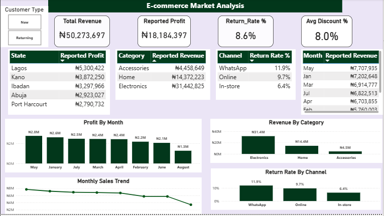

# E-commerce Market Analysis | Dashboard Audit (Power BI)

An independent project based on the DSN AI Bootcamp 2026 data analytics challenge brief. I reviewed a retail transaction dataset, cleaned it in Power Query, and rebuilt a management dashboard in Power BI to check which of the original conclusions the data actually supports.

## Table of Contents
1. [Project Overview](#1-project-overview)
2. [Dataset](#2-dataset)
3. [Data Cleaning](#3-data-cleaning)
4. [Dashboard](#4-dashboard)
5. [Key Findings](#5-key-findings)
6. [Management Claims Reviewed](#6-management-claims-reviewed)
7. [Recommendations](#7-recommendations)
8. [Limitations](#8-limitations)
9. [Author](#9-author)

---

## 1. Project Overview

**Context:** A retail business had presented a dashboard to management, with a set of conclusions drawn from its transaction data.

**Problem:** Dashboards are only as reliable as the data behind them. The raw file contained inconsistent labels and duplicate records, so some of the original conclusions could be wrong or misleading.

**Approach:** I cleaned the data in Power Query, rebuilt the dashboard in Power BI, and compared the corrected view with the original claims.

**Outcome:** A corrected dashboard covering KPIs, state, category, channel and monthly performance, plus a review of which management conclusions hold up.

## 2. Dataset

- 432 retail transactions recorded between January and August 2026
- Five states (Lagos, Kano, Abuja, Ibadan, Port Harcourt), three sales channels (In-store, Online, WhatsApp) and three product categories (Electronics, Home, Accessories)
- 16 fields, including date, store, state, channel, product and category, customer type, units, unit price, discount, reported revenue, unit cost, return flag and sales representative

The dataset was provided as part of the challenge and is not redistributed in this repository.

## 3. Data Cleaning

Done in Power Query (Power BI Desktop):

- Removed duplicate transaction records
- Standardised inconsistent state names (for example, Lagos recorded in several spellings and cases) so one state is not split across rows
- Standardised inconsistent product category labels

Merging the split Lagos labels changed the state ranking, which is why the profit conclusion in the original dashboard did not hold.

## 4. Dashboard

Built in Power BI with:

- **KPI cards:** Total Revenue, Reported Profit, Return Rate % and Average Discount %
- **State view:** profit by state
- **Category view:** revenue by product category
- **Channel view:** return rate by sales channel
- **Monthly view:** revenue and profit by month, plus a monthly sales trend
- **Customer Type filter:** New or Returning customers

## 5. Key Findings

- **Return rate:** 8.6% overall, and the average discount was 8.0%.
- **Channel returns:** In-store had the lowest return rate (6.4%), followed by Online (9.7%) and WhatsApp (11.9%).
- **Most profitable state:** Lagos led profit.
- **Category:** Electronics generated the largest share of revenue, ahead of Home and Accessories.
- **Monthly pattern:** May had the highest revenue; August was the lowest, but the data ends on 26 August, so August is a partial month.

## 6. Management Claims Reviewed

| Original claim | Verdict | Evidence |
|---|---|---|
| Abuja is the most profitable market | Incorrect | Lagos leads profit once its split labels are merged |
| Online has the lowest return rate | Incorrect | In-store is lowest at 6.4%; Online is 9.7% |
| August is the strongest sales month | Incorrect | August is the lowest month, and its data is incomplete |
| Lagos is underperforming | Incorrect | Lagos is the top state by profit |

## 7. Recommendations

1. **Investigate returns in WhatsApp and Online orders.** Their return rates (11.9% and 9.7%) are well above In-store (6.4%).
2. **Use Lagos as the benchmark market.** Review what drives its performance and whether it can be repeated in other states.
3. **Compare full months only.** Leave out partial months, such as August here, when judging trends.
4. **Validate revenue and profit before financial decisions.** See the limitations below.

## 8. Limitations

- The data covers January to August 2026 and ends on 26 August, so it is a snapshot, not a full year.
- The raw file also contains missing unit costs and rows where the reported revenue differs from units multiplied by price after discount. Revenue and profit figures should be validated against these before they are used for financial decisions.
- The analysis shows patterns, not causes. It does not explain why one state or channel performs differently.

## 9. Author

**Olukunle Oyewale** | Data Analyst

- [LinkedIn](https://www.linkedin.com/in/olukunle034/)
- [Portfolio](https://kunlez01.github.io/kunlez.github.io/)
- [GitHub](https://github.com/Kunlez01)

*Last updated: November 2026*
